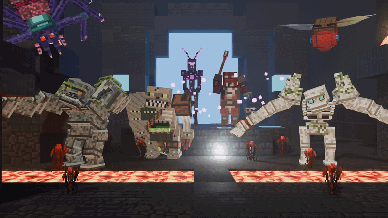
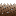

# X Mobs (`x_mobs`)

[](https://content.luanti.org/packages/SaKeL/x_mobs/)
[](https://content.luanti.org/packages/SaKeL/x_mobs/)

[](LICENSE.txt)
[](LICENSE.txt)




High-performance mobs and boss framework for Luanti featuring original 3D models with glTF 2.0 multi-track skeletal animations, multi-phase combat mechanics, and dynamic entity visual controls.

## Features

- **glTF 2.0 Multi-Track Animations**: Custom-authored 3D models with named animation tracks optimized for Luanti 5.17.0+ skeletal playback, following Unreal Engine Mannequin animation and movement principles (anticipation, weight shift, secondary wave lag, and momentum follow-through).
- **Nether Arachnid (Spider Mob)**: A predatory multi-legged arachnid mob featuring 23-bone dual-jointed skeletal rigging (Femur Upper + Tibia Lower), articulated fangs and pedipalps, an alternating tetrapod gait walk and run cycle, wall and ceiling climbing with surprise ceiling ambush drops, long-range pounce leaps, ranged web silk sprays, venomous fang strikes, tactical low-health retreat regeneration, swarm alerting, and an iconic arachnid death curl animation where all 8 legs contract inward.
- **Fallen Shaman & Minions**: Cunning cultist sorcerer that maintains standoff distance to hurl explosive fireball projectiles while summoning up to 3 Fallen Minions directly between itself and players as an interposing meat-shield.
- **Skull Legion**: Undead skeletal forces featuring the high-poise Skull King boss, aggressive Skull Lancers, and sharpshooting Skull Archers with directional bone aiming, arrow projectiles, soul essence healing, and bone dust VFX.
- **Crystal Guardian & Minions**: Ancient towering crystalline golem with dense basalt and amethyst armor (`fleshy = 50, cracky = 70`), high health pool (140 HP), passive regenerative crystal core, stalwart persistence (never flees), bonded pair combat coordination, and a seismic Ground Smash AoE attack (20% chance) featuring plane-attracted shockwave particles, flying basalt debris, terrain debris mapping (ice chunks on ice, stone particles on stone), and directional player knockback across a 5-block radius. Pickaxes exploit its targeted crystalline weak point (`cracky = 70`), dealing heightened armor-piercing damage compared to deflected slashing blades (`fleshy = 50`). Supported by player-scale **Crystal Guardian Minions** (`x_mobs:crystal_guardian_minion`, 70 HP, `fleshy = 75, cracky = 85`, 3 damage) that rally in squads around the guardian and unleash localized shockwaves.
- **Golem & Minions**: Ancient colossal stone titan (160 HP) defending subterranean caverns, mountain peaks, and rocky crags. Features heavy basalt armor (`fleshy = 40, cracky = 90`), near-total knockback resistance (`knockback_mult = 0.1`), 8 clean canonical glTF 2.0 animation tracks (`idle`, `walk`, `run`, `punch2`, `punch`, `shoot`, `hurt`, `death`), swift martial cross-punches (`punch2`), a seismic ground smash (20% chance, `punch`) unleashing expanding planar shockwaves with kinetic player lift and terrain-mapped debris, a defensive hit reaction (`hurt`) where its left arm and stone fist raise in front of its face to cover from blows, and a signature two-stage dynamic boulder projectile attack (`shoot`) utilizing Luanti's `visual = "node"` rendering where a boulder dynamically extracts and levitates vertically from the ground before launching with aim-prediction ballistics and continuous world x/z tumbling rotation. Supported by player-scale **Golem Minions** (`x_mobs:golem_minion`, 80 HP, `fleshy = 70, cracky = 95`, 3 damage) that accompany the titan, hurl smaller ground-extracted boulders (`x_mobs:golem_minion_boulder`), and perform coordinated tactical melee.
- **Nature Guardian**: Colossal ancient timber golem (120 HP) defending sacred groves and old-growth canopies. Features 5 seasonal autumn bark variations via native Luanti HSL texture modifiers, open-sky sunlight photosynthesis regeneration, devastating melee combos alternating swift punches and heavy shockwave slams, all 10 glTF 2.0 animation tracks (`idle`, `stand`, `walk`, `run`, `punch`, `attack`, `cast`, `spell`, `death`, `die`), and an Entangling Roots spell that immobilizes intruders at mid-range (6–16 blocks) by erupting gnarled roots from the ground utilizing the core envelop visual subsystem and zeroing movement speed and jump.
- **Armored Bug**: Autonomous 3D flocking flyers utilizing the high-performance Swarm Intelligence subsystem with Boids repulsion, dynamic waypoint following, high-frequency wing oscillation, and coordinated hive mind attacks.
- **Flying Insect**: Fragile airborne swarm insect featuring unarmored carapace (`fleshy = 100`), lower health (24 HP) and attack damage, multi-track glTF animations (`idle`, `stand`, `walk`, `run`, `attack`, `death`), custom pixel-art particles for organic carapace, gossamer wings, and hemolymph, and native Luanti HSL texture modifiers (`^[hsl:`) creating rich brown phenotype color variations across swarms.
- **Skeleton Swordfish**: Undead pelagic predator mob utilizing `x_mob_core`'s fish schooling architecture with Leader-Follower Anchor Steering, 3D obstacle and boundary avoidance, multi-track glTF animations (`stand`, `idle`, `walk`, `run`, `attack`, `death`), zero-drift anatomical keyframe pivots, and democratic leader succession. Spawns naturally in oceanic waters while strictly excluding river systems.
- **Crazy Mushroom (Boss)**: A cunning fungal boss mob that commands a vanguard of 3 Fungus Minions. Features glTF 2.0 multi-track animations (`stand`, `walk`, `run`, `shoot`, `punch`, `death`), spore ball projectile attacks at mid-range, unarmored vulnerability (`fleshy = 90`), tactical kiting with slower retreat speed than players (`walk_speed = 3.0`, `retreat_speed = 2.8`), instant transition to a rapid cross-punch melee combo when players catch up within 3 blocks, and tactical retreat behind its minion vanguard to regenerate health when below 30% HP.
- **Fungus Minion**: Fast and aggressive fungal swarmers (`pursuit_speed = 5.2`) that serve as loyal shock-troops to the Crazy Mushroom boss. Features glTF 2.0 multi-track animations (`stand`, `walk`, `run`, `punch`, `death`), lunging punch attacks, and tight squad coordination rallying to protect the boss.
- **Dynamic Particle Systems**: Advanced particle effects using modern Luanti particle APIs (texpools, drag, jitter, bounce, scale/alpha tweens, plane attractors, line attractors, and glow) for venom droplets, web silk wisps, bone dust, crystal shards, and skittering dust.

---

## Monster Bestiary & Combat Encyclopedia

`x_mobs` introduces 28 highly specialized creatures, elite guardians, and multi-phase bosses to Luanti. Every creature features custom glTF 2.0 multi-track animations, distinct poise dynamics, physical armor ratings, and an extensive spell casting system tied directly to visual envelop overlays.

---

### Status Effects & Visual Envelop Reference

Many monsters cast spells or execute special strikes that envelop players or allies in 16x16 pixel-art status auras. These envelops attach directly to victim collision boxes, providing instant visual feedback for buffs and debuffs.

| Envelop | Preset Name | Category | Effects & Mechanics | Cast By / Associated Mobs |
|:---:|:---|:---:|:---|:---|
|  | `fire` / `magma_burn` | Debuff (DoT) | **1–2 HP/s Fire Damage** for 3.0–5.0s, accompanied by thermal smoke and orange flame sheet particles. Inflicts 50% movement slow on pyre entrapment. | Heated Sword, Fallen Shaman, Glowler |
|  | `ice` / `freeze` | Debuff (Slow / Root) | **50% Movement Slow** for 6.0s (or complete **Root** for 2.5s) with blizzard vortex particles and crystalline frost shatter audio upon expiration. | Frosty Queen |
|  | `roots` | Debuff (Root) | **100% Movement & Jump Immobilization** (`speed = 0`, `jump = 0`) for 3.0–6.0s. Physical timber roots erupt from the ground beneath the target's feet. | Nature Guardian, Nature Guardian Minion |
|  | `mud` / `tremor_stagger` | Debuff (Slow & Gravity) | **50% Movement Slow** and **Earth Anchor** (2.2x–2.4x downward gravity pull + jump suppression) for 3.0–4.0s with stone crumble debris. | Golem, Golem Minion, Dungeon Brute |
|  | `venom` / `necrotic_decay` | Debuff (DoT & Poison) | **1–2 HP/s Poison Damage** for 3.0–6.0s. `necrotic_decay` also applies 35% movement slow with noxious green bubbles and bile droplets. | Nether Arachnid, Chasm Weaver, Suture Golem |
|  | `web` | Debuff (Slow) | **50%–70% Movement Slow** (`speed = 0.3–0.5`, `jump = 0.5`) for 3.0–4.0s with silk web strands wrapping the victim. | Nether Arachnid, Chasm Weaver |
|  | `void` / `void_rend` / `distortion` | Debuff (DoT & Slow) | **2 HP/s Void / Bleed Damage** for 3.0–5.0s, 45%–55% movement slow, low-gravity float, and caster lifesteal siphon. | Spectrum Demon, Void Strider |
|  | `spore` | Debuff (Slow) | **40% Movement Slow** (`speed = 0.6`) for 5.0s with drifting purple fungal spore clouds and impaired agility. | Crazy Mushroom, Fungus Minion |
|  | `swarm` / `urticating_itch` | Debuff (DoT / Slow) | **1 HP/s Stinging DoT** (3.0s) or **30% Urticating Slow** (2.5s) from bristling setae and insect swarms. | Armored Bug, Flying Insect, Glowler Minion, Chasm Weaver |
|  | `bone` | Debuff (Slow) | **60% Movement Slow** (`speed = 0.4`) for 4.0s from necrotic soul harvest and calcifying bone dust. | Skull King |
|  | `crystal` | Debuff (Root) | **Full Physical Root** (3.0s) with amethyst crystalline facet encasement from seismic ground smashes. | Crystal Guardian, Crystal Guardian Minion |
|  | `smoke` | Debuff (Disruption) | **Choking Ash & Smoke Screen** (4.0s) blinding targets and masking movement post-detonation. | Elder |
|  | `brine` | Debuff (Slow) | **50% Aquatic Drag Slow** for 4.0s from deep-sea bone chills and pelagic wake turbulence. | Skeleton Swordfish |
|  | `haste` | Positive Buff | **+30%–45% Movement Speed Surge** with kinetic wind streaks during pursuit sprints or tactical ambush leaps. | Nether Arachnid, Crypt Stalker |
|  | `frenzy` / `bloodlust` | Positive Buff / Bleed | **+40% Attack Speed & Frenzied Agility** when provoked or cornered; also used tinted crimson for **Bleed** DoT. | Skull King, Glowler, Fallen Shaman, Crypt Stalker |
|  | `ironhide` / `carapace` | Positive Buff | **Reinforced Chitin Armor** absorbing incoming kinetic shock and deflecting light strikes. | Armored Bug |
|  | `rejuvenation` / `mending` | Positive Buff | **Continuous Health Regeneration** (+2 to +4 HP/s) with emerald sparkle particles while channeling in tactical retreat. | Crazy Mushroom, Fallen Shaman |
|  | `solar_surge` / `radiance` | Positive Buff / Flash | **Incandescent Solar Shield** and blinding stellar illumination triggered during supernova detonations. | Glowler |
|  | `barrier` | Positive Buff | **Protective Mystic Ward** mitigating incoming physical damage while summoning reinforcements. | Skull King, Fallen Shaman |
|  | `shadow_march` | Positive Buff | **Umbral Shroud** granting increased poise and threat presence to undead vanguard leaders. | Skull King |

---

### 1. Ancient Titans & Golems

#### Golem (`x_mobs:golem`)
- **Archetype / Type**: Boss Titan / Subterranean Living Stone Colossus
- **Combat Style**: Seismic Melee & Dynamic Earth Extraction Shooter
- **Base Attributes**:
  - **Health (HP)**: 160 HP
  - **Armor Groups**: `fleshy = 40, cracky = 90` *(Takes 60% reduced damage from swords, bows, and unarmed attacks; highly vulnerable to pickaxes!)*
  - **Melee Damage**: 7 damage (Primary Cross-Punch) / 8 damage (Ground Smash)
  - **Movement Speed**: Walk = 2.0, Pursuit = 3.6, Tactical Flee = 3.8
  - **Reach / Combat Range**: Melee Reach = 3.2 blocks, Ranged Shoot Range = 7.5–18.0 blocks
  - **Poise / Knockback**: `knockback_mult = 0.1` *(90% knockback resistance; near-total unyielding hyper-armor)*
- **Special Abilities & Spells**:
  - **Seismic Ground Smash (`punch`)**:
    - *Trigger & Cooldown*: 20% chance on close-quarters melee swing (< 3.2m).
    - *Mechanics*: Slams both colossal stone fists into the terrain, unleashing an expanding radial shockwave (3.8-block radius) with kinetic lift that propels victims into the air accompanied by terrain-mapped flying debris (ice chunks on ice, stone on rock).
    - *Effects*: Deals 8 AoE damage, heavy vertical knockup, and inflicts Earth Anchor with  **`mud`** (2.4x downward gravity pull and jump suppression).
  - **Earth Extraction & Boulder Hurl (`shoot`)**:
    - *Trigger & Cooldown*: Cast from distance (7.5–18.0 blocks) when target is out of melee range; 3.5s cooldown.
    - *Mechanics*: The Golem points at the terrain, dynamically levitating an authentic local ground block (`visual = "node"`) 2.4 blocks vertically into the air before hurling it with predictive aim ballistics (velocity 20) and continuous world X/Z tumbling rotation.
    - *Effects*: Deals 7 direct kinetic damage upon impact, 4 splash damage in a 2.5-block radius, and envelops victims in  **`mud`** (Earth Anchor slow and gravity pull).
  - **Defensive Hit Reaction (`hurt`)**:
    - *Mechanics*: When struck, raises its left forearm and stone fist in front of its face to shield its core from incoming blows.
  - **Tactical Ranged Disengagement**:
    - *Trigger*: When health drops below 25% (40 HP).
    - *Mechanics*: Enters a tactical retreat sprint (speed 3.8), keeping distance bounded at 14 blocks while continuously pelting pursuers with extracted boulders until vitality regenerates above 70 HP.

#### Golem Minion (`x_mobs:golem_minion`)
- **Archetype / Type**: Vanguard Stone Golem / Cavern Sentinel
- **Combat Style**: Coordinated Melee & Minor Boulder Toss
- **Base Attributes**:
  - **Health (HP)**: 80 HP
  - **Armor Groups**: `fleshy = 70, cracky = 95` *(Pickaxe vulnerable)*
  - **Melee Damage**: 3 damage (Cross-Punch) / 4 damage (Mini Ground Slam)
  - **Movement Speed**: Walk = 2.2, Pursuit = 3.8, Tactical Flee = 4.0
  - **Reach / Combat Range**: Melee Reach = 2.1 blocks, Shoot Range = 6.0–16.0 blocks
  - **Poise / Knockback**: `knockback_mult = 0.35` *(65% knockback resistance)*
- **Special Abilities & Spells**:
  - **Mini Earth Extraction (`shoot`)**:
    - *Trigger & Cooldown*: Range 6.0–16.0 blocks, 3.0s cooldown.
    - *Mechanics*: Extracts a compact cobblestone boulder from the ground and hurls it with predictive velocity (speed 18).
    - *Effects*: Deals 3 damage and inflicts  **`mud`** (2.2x downward gravity anchor).
  - **Tactical Vanguard Retreat**:
    - *Trigger*: Disengages below 20 HP, pelting pursuers with rocks until regenerating past 35 HP.

#### Crystal Guardian (`x_mobs:crystal_guardian`)
- **Archetype / Type**: Boss Golem / Ancient Amethyst Titan
- **Combat Style**: Stalwart Melee Shockwave & Crystalline Encasement
- **Base Attributes**:
  - **Health (HP)**: 140 HP
  - **Armor Groups**: `fleshy = 50, cracky = 70` *(Deflects 50% slashing blade damage; heavy pickaxe weak point)*
  - **Melee Damage**: 6 damage (Crystal Knuckle) / 6 damage (Ground Smash AoE)
  - **Movement Speed**: Walk = 2.4, Pursuit = 4.2, Flee = Never flees (Stalwart)
  - **Reach / Combat Range**: Melee Reach = 3.0 blocks
  - **Poise / Knockback**: `knockback_mult = 0` *(100% knockback immunity; absolute poise)*
- **Special Abilities & Spells**:
  - **Crystalline Ground Smash (`punch`)**:
    - *Trigger & Cooldown*: 20% chance on melee attack (< 3.0m).
    - *Mechanics*: Channels raw crystal resonance into both fists, striking the floor with resonant fracture audio. Sends expanding planar amethyst shockwaves across a 5.0-block radius, spraying flying basalt shards and biome-mapped debris.
    - *Effects*: Deals 6 AoE damage, throws players into the air with heavy kinetic lift, and encases targets in  **`crystal`** (Full movement root for 3.0s).
  - **Crystal Core Regeneration**:
    - *Mechanics*: Passively repairs crystalline fractures, regenerating vitality continually during combat.
  - **Bonded Pair Combat**:
    - *Mechanics*: Spawns and fights in bonded pairs across deep subterranean crystal vaults, coordinating focus-fire on common threats.

#### Crystal Guardian Minion (`x_mobs:crystal_guardian_minion`)
- **Archetype / Type**: Vanguard Crystal Sentinel / Player-Scale Escort
- **Combat Style**: Squad Melee & Localized Shockwaves
- **Base Attributes**:
  - **Health (HP)**: 70 HP
  - **Armor Groups**: `fleshy = 75, cracky = 85` *(Pickaxe vulnerable)*
  - **Melee Damage**: 3 damage
  - **Movement Speed**: Walk = 2.6, Pursuit = 4.4, Flee = Never flees
  - **Reach / Combat Range**: Melee Reach = 2.2 blocks
  - **Poise / Knockback**: `knockback_mult = 0.35`
- **Special Abilities & Spells**:
  - **Localized Crystal Burst**:
    - *Mechanics*: Slams the floor in a 3.0-block radius, dealing 3 damage and applying  **`crystal`** (Root for 3.0s).

#### Nature Guardian (`x_mobs:nature_guardian`)
- **Archetype / Type**: Boss Colossus / Sacred Grove Timber Titan
- **Combat Style**: Devastating Melee Combos & Mid-Range Entangling Roots Caster
- **Base Attributes**:
  - **Health (HP)**: 120 HP
  - **Armor Groups**: `fleshy = 65, choppy = 120` *(35% sword resistance; highly vulnerable to lumber axes)*
  - **Melee Damage**: 5 damage (Swift Punch) / 9 damage (Heavy Slam)
  - **Movement Speed**: Walk = 2.0, Pursuit = 3.8, Flee = Never flees
  - **Reach / Combat Range**: Melee Reach = 3.2 blocks, Spell Cast Range = 6.0–16.0 blocks
  - **Poise / Knockback**: `knockback_mult = 0.15` *(85% knockback resistance; hyper-armor during spells)*
- **Special Abilities & Spells**:
  - **Entangling Roots Spell (`spell` / `cast`)**:
    - *Trigger & Cooldown*: Cast from mid-range (6.0–16.0 blocks) when target is out of melee range; 12.0s cooldown.
    - *Mechanics*: Channels ancient nature runes into its timber fists (keyframe frame 30 ground strike) and slams the earth with timber crackle audio. Twisted roots erupt instantaneously around the target's feet.
    - *Effects*: Envelops the victim in  **`roots`**, completely freezing movement and jumping (`speed = 0`, `jump = 0`) for 6.0 seconds. Features emerald nature particle rings and ground shatter audio upon expiration.
  - **Open-Sky Photosynthesis**:
    - *Mechanics*: Passively regenerates vitality whenever standing under open sky in direct sunlight (`light >= 12`).
  - **Seasonal Autumn Foliage**:
    - *Phenotypes*: Automatically exhibits 5 rich seasonal autumn bark colorways (`Amber`, `Crimson Maple`, `Golden Birch`, `Russet Oak`, `Withered Evergreen`) via native Luanti HSL shaders.

#### Nature Guardian Minion (`x_mobs:nature_guardian_minion`)
- **Archetype / Type**: Grove Vanguard Sentinel / Forest Sentry
- **Combat Style**: Escort Melee & Compact Entangling Roots
- **Base Attributes**:
  - **Health (HP)**: 60 HP
  - **Armor Groups**: `fleshy = 85, choppy = 135` *(Axe vulnerable)*
  - **Melee Damage**: 1.5 damage (Punch) / 3 damage (Heavy Slam)
  - **Movement Speed**: Walk = 2.2, Pursuit = 4.0, Flee = Never flees
  - **Reach / Combat Range**: Melee Reach = 2.1 blocks, Spell Range = 5.0–12.0 blocks
  - **Poise / Knockback**: `knockback_mult = 0.35`
- **Special Abilities & Spells**:
  - **Minor Entangling Roots (`spell`)**:
    - *Trigger & Cooldown*: Range 5.0–12.0 blocks, 14.0s cooldown.
    - *Effects*: Erupts roots around intruder feet, applying  **`roots`** (Full immobilization for 3.0s).

---

### 2. Arachnid Predators

#### Nether Arachnid (`x_mobs:spider`)
- **Archetype / Type**: Predatory Arachnid / Dual-Jointed Cavern Hunter
- **Combat Style**: Multi-Surface Ambush, Pounce Leap & Viscous Silk Caster
- **Base Attributes**:
  - **Health (HP)**: 40 HP
  - **Armor Groups**: `fleshy = 80`
  - **Melee Damage**: 5 damage (Fang Bite) / 7 damage (Landing Slam)
  - **Movement Speed**: Walk = 3.8, Pursuit = 5.5 (Surges with Haste)
  - **Reach / Combat Range**: Melee Reach = 2.4 blocks, Web Range = 3.5–10.5 blocks, Pounce Range = 4.5–10.5 blocks
  - **Poise / Knockback**: `knockback_mult = 2.0` *(Agile, high recoil from heavy weapons)*
- **Special Abilities & Spells**:
  - **Venom Poisoning Spell (`x_mobs.cast_venom_envelop`)**:
    - *Trigger & Cooldown*: 20% chance on fang bite; 6.0s cooldown, max range 7.0 blocks.
    - *Effects*: Envelops target in  **`venom`**, inflicting 1 HP/s poison DoT for 3.0 seconds.
  - **Web Silk Slowdown Spell (`x_mobs.cast_web_envelop`)**:
    - *Trigger & Cooldown*: 20% chance on web silk shot; 6.0s cooldown.
    - *Effects*: Wraps target in sticky webbing with  **`web`**, slowing movement by 50% (`speed_factor = 0.50`) for 3.0 seconds.
  - **Skitter Haste**:
    - *Trigger*: Long-distance pursuit (> 8.0 blocks).
    - *Effects*: Gains  **`haste`**, boosting sprint pursuit speed to 5.5.
  - **Ceiling Drop Plunge Attack**:
    - *Trigger*: When perching inverted on dark cavern roofs directly above a player.
    - *Effects*: Plunges vertically downward dealing 7 physical slam damage on impact.
  - **Iconic Arachnid Death Curl**:
    - *Mechanics*: Upon death, all 8 dual-jointed legs contract inward toward the cephalothorax in a biological death curl.

#### Chasm Weaver (`x_mobs:chasm_weaver`)
- **Archetype / Type**: Apex Subterranean Tarantula / Giant Burrowing Stalker
- **Combat Style**: Precision Silk Sniping, Heavy Pounces & Acidic Spores
- **Base Attributes**:
  - **Health (HP)**: 50 HP
  - **Armor Groups**: `fleshy = 75`
  - **Melee Damage**: 7 damage (Impaling Strike) / 8 damage (Pounce Slam)
  - **Movement Speed**: Walk = 3.8, Pursuit = 5.6 (Dark burst speed 5.8)
  - **Reach / Combat Range**: Melee Reach = 2.4 blocks, Bolt Range = 18.0 blocks, Pounce Range = 4.5–12.0 blocks
  - **Poise / Knockback**: `knockback_mult = 1.8`
- **Special Abilities & Spells**:
  - **Silk Web Bolt (`shoot`)**:
    - *Mechanics*: Snipes with high-velocity web bolts (speed 18), dealing 5 direct damage (3 splash) and applying  **`web`** (50% slow for 3.0s).
  - **Iridescent Jewel Spore (Rare Spell Shot)**:
    - *Trigger*: 20% chance on ranged shooting.
    - *Mechanics*: Launches a pressurized jewel spore pod (speed 14) that detonates in a massive acid-silk explosion (4.0-block radius).
    - *Effects*: Deals 9 direct + 4 acidic damage (6 splash), simultaneously enveloping all caught victims in  **`web`** (80% slow) and  **`venom`** (Poison DoT).
  - **Defensive Urticating Setae Discharge**:
    - *Trigger*: Taking heavy damage blows.
    - *Mechanics*: Discharges an irritating bristle cloud around itself, enveloping attackers in amber  **`urticating_itch`** (30% speed reduction for 2.5s).
  - **4 Authentic Tarantula Phenotypes**:
    - Features *Brazilian Jewel*, *Indian Ornamental*, *Antilles Pinktoe*, and *Obsidian Chasm Weaver* colorways.

---

### 3. The Skull Legion & Crypt Horrors

#### Skull King (`x_mobs:skull_king`)
- **Archetype / Type**: Undead Warlord Boss / Skull Legion Sovereign
- **Combat Style**: Heavy Melee Combos, Minion Summons & Defensive Wards
- **Base Attributes**:
  - **Health (HP)**: 120 HP
  - **Armor Groups**: `fleshy = 80`
  - **Melee Damage**: 8 damage (Heavy Bone Punch combo)
  - **Movement Speed**: Walk = 3.5, Pursuit = High poise march
  - **Reach / Combat Range**: Melee Reach = 3.0 blocks
  - **Poise / Knockback**: `knockback_mult = 0.3` *(70% knockback resistance; stalwart boss poise)*
- **Special Abilities & Spells**:
  - **Legion Reinforcement Summoning (`shoot`)**:
    - *Trigger & Cooldown*: When guard retinue falls below 3 minions; 2.0s cooldown, up to 24 lifetime summons.
    - *Mechanics*: Raises skeletal arms to summon Skull Lancers and Skull Archers directly from bone dust.
    - *Defensive Buffs*: Surrounds itself in  **`barrier`** and  **`shadow_march`** while channeling.
  - **Soul Harvest Calcification**:
    - *Mechanics*: Strikes leach vitality and apply  **`bone`**, slowing victim movement to 40% speed for 4.0s with calcifying bone dust particles.
  - **Tactical Soul Essence Retreat**:
    - *Trigger*: When health drops below 25 HP.
    - *Mechanics*: Disengages behind surviving Lancers, channeling soul essence particles to recover vitality before counter-attacking.

#### Skull Lancer (`x_mobs:skull_lancer`)
- **Archetype / Type**: Undead Shock-Troop / Frontline Spearman
- **Combat Style**: High-Speed Charging Melee
- **Base Attributes**:
  - **Health (HP)**: 25 HP
  - **Armor Groups**: `fleshy = 100`
  - **Melee Damage**: 5 damage (Spear Thrust)
  - **Movement Speed**: Walk = 3.8, Pursuit = 5.2
  - **Reach / Combat Range**: Melee Reach = 2.5 blocks
  - **Poise / Knockback**: `knockback_mult = 0.3`
- **Special Abilities**:
  - **Focus Fire Coordination**:
    - *Mechanics*: Instantly aggros and charges any player who strikes the Skull King.

#### Skull Archer (`x_mobs:skull_archer`)
- **Archetype / Type**: Undead Sharpshooter / Skeletal Bow Guard
- **Combat Style**: Predictive Aim Ranged Bow & Mobile Kiting
- **Base Attributes**:
  - **Health (HP)**: 20 HP
  - **Armor Groups**: `fleshy = 100`
  - **Ranged Damage**: 5 damage (`x_mobs:archer_arrow`)
  - **Movement Speed**: Walk = 3.5, Pursuit = 4.0, Kiting Retreat = 3.5
  - **Reach / Combat Range**: Range = 5.0–16.0 blocks
  - **Poise / Knockback**: `knockback_mult = 0.3`
- **Special Abilities & Spells**:
  - **Predictive Arrow Ballistics**:
    - *Mechanics*: Dynamically leads moving player trajectories with custom arrows (speed 18), firing every 2.5s with directional upper-torso bone aiming.
  - **Kite & Shoot**:
    - *Mechanics*: Backpedals away from closing melee attackers while continuously drawing and firing arrows.

#### Crypt Stalker (`x_mobs:crypt_stalker`)
- **Archetype / Type**: Apex Subterranean Shadow Predator / Blind Echolocator
- **Combat Style**: Echolocation Ambush, Bleed Rends & Sonic Shrieks
- **Base Attributes**:
  - **Health (HP)**: 105 HP
  - **Armor Groups**: `fleshy = 80, snappy = 85`
  - **Melee Damage**: 7 damage (Razor Claw Rend) / 12 damage (Twin Mantis X-Slash)
  - **Movement Speed**: Walk = 3.6, Pursuit = 5.8 (Surges to 6.4 in dark caverns)
  - **Reach / Combat Range**: Melee Reach = 2.6 blocks, Shriek Range = 16.0 blocks
  - **Poise / Knockback**: `knockback_mult = 1.6`
- **Special Abilities & Spells**:
  - **Crypt Laceration Bleed**:
    - *Mechanics*: Primary claw rend inflicts deep arterial cuts enveloped in crimson  **`crypt_laceration`** (1 bleed DoT / 1.0s for 2.5s).
  - **Supersonic Shriek Pulse (`shoot`)**:
    - *Trigger & Cooldown*: Range 5.0–16.0 blocks, 4.0s cooldown.
    - *Mechanics*: Emits a high-frequency acoustic shockwave (speed 22) that blasts victims backward with heavy concussive knockback.
  - **Shadow Prowler Surge**:
    - *Mechanics*: Gathers haste mist in the dark, bursting forward with  **`haste`** (+30% pursuit speed).

#### Suture Golem (`x_mobs:suture_golem`)
- **Archetype / Type**: Undead Flesh-Iron Juggernaut / Necrotic Abomination
- **Combat Style**: Cleaver Sweeps, Ground Ruptures & Corrosive Bile
- **Base Attributes**:
  - **Health (HP)**: 85 HP
  - **Armor Groups**: `fleshy = 85, cracky = 60, level = 2` *(Reinforced iron wire)*
  - **Melee Damage**: 9 damage (Cleaver Sweep) / 12 damage (Ground Rupture AoE)
  - **Movement Speed**: Walk = 2.4, Pursuit = 4.2
  - **Reach / Combat Range**: Melee Reach = 2.6 blocks, Bile Range = 16.0 blocks
  - **Poise / Knockback**: `knockback_mult = 0.50` *(50% knockback resistance)*
- **Special Abilities & Spells**:
  - **Double-Fist Ground Rupture (`punch2`)**:
    - *Mechanics*: Slams both stitched fists down, releasing a toxic bile shockwave dealing 12 damage and knocking targets into the air.
  - **Necrotic Bile Vomit (`shoot`)**:
    - *Trigger & Cooldown*: Range 5.0–16.0 blocks, 4.0s cooldown.
    - *Mechanics*: Spews corrosive bile globules that splatter on terrain.
    - *Effects*: Deals 2 direct + 1 splash damage and inflicts  **`necrotic_decay`** (2 poison DoT / 1.0s and 35% movement slow for 4.0s).
  - **Suture Regeneration**:
    - *Trigger*: Health < 35%. Knits severed stitches to passively regenerate lost flesh.

---

### 4. Subterranean Brutes, Elementals & Cosmic Predators

#### Dungeon Brute (`x_mobs:dungeon_brute`)
- **Archetype / Type**: Colossal Armored Vault Enforcer / Ironclad Golem
- **Combat Style**: Crushing Knuckle Punches, Tremor Slams & Masonry Hurl
- **Base Attributes**:
  - **Health (HP)**: 125 HP
  - **Armor Groups**: `fleshy = 65, cracky = 50, level = 2` *(Heavy iron pauldrons)*
  - **Melee Damage**: 8 damage (Iron Knuckle) / 9 damage (Tremor Execution Slam)
  - **Movement Speed**: Walk = 3.2, Pursuit = 5.2
  - **Reach / Combat Range**: Melee Reach = 3.0 blocks, Boulder Range = 18.0 blocks
  - **Poise / Knockback**: `knockback_mult = 0.65`
- **Special Abilities & Spells**:
  - **Tremor Execution Slam (`punch2`)**:
    - *Trigger & Cooldown*: 4.5s cooldown in close melee.
    - *Mechanics*: Slams both iron knuckles into the floor, triggering a 360-degree radial fissure shockwave with debris splash.
    - *Effects*: Deals 9 damage, lifts players upward, and applies  **`tremor_stagger`** (50% movement slow for 3.0s).
  - **Seismic Boulder Hurl (`shoot`)**:
    - *Mechanics*: Tears out and hurls massive dungeon stone blocks (speed 18, range 18m, damage 7) with explosive shrapnel.
  - **Staggering War Cry**:
    - *Trigger*: Taking single blows > 8 damage.
    - *Mechanics*: Roars with cavern-shaking audio, alerting all dungeon allies within 24 blocks.

#### Heated Sword (`x_mobs:heated_sword`)
- **Archetype / Type**: Volcanic Greatsword Elemental Boss / Living Magma Blade
- **Combat Style**: Greatsword Cleaves, Fissure Slams & Infernal Pyre Caster
- **Base Attributes**:
  - **Health (HP)**: 95 HP
  - **Armor Groups**: `fleshy = 65, cracky = 50, fire = 0` *(100% immune to fire, lava, and ignite debuffs!)*
  - **Melee Damage**: 8 damage (Thermal Cleave) / 10 damage (Fissure Slam)
  - **Movement Speed**: Walk = 2.8, Pursuit = 4.8, Tactical Flee = 5.0, Retreat = 1.0
  - **Reach / Combat Range**: Melee Reach = 2.8 blocks, Fireball Range = 5.0–18.0 blocks
  - **Poise / Knockback**: `knockback_mult = 0.6`
- **Special Abilities & Spells**:
  - **Infernal Pyre Envelop Spell (`x_mobs.cast_fire_envelop`)**:
    - *Trigger & Cooldown*: Cast from distance (5.0–18.0 blocks), 12.0s cooldown.
    - *Mechanics*: Chants with crackling volcanic energy, trapping the victim in a towering pillar of roaring flame.
    - *Effects*: Envelops target in  **`fire`** (**50% movement slow** and **2 HP/s continuous burn DoT** for 5.0 seconds).
  - **Blazing Greatsword Cleave (`punch`)**:
    - *Mechanics*: Sweeps its incandescent blade, dealing 8 thermal damage and igniting victims for 1 fire DoT.
  - **Volcanic Fissure Slam (`punch2`)**:
    - *Mechanics*: Drives the greatsword into the floor, detonating a 10-damage radial magma rupture.
  - **Magma Core Fireball (`shoot`)**:
    - *Mechanics*: Launches molten magma orbs (speed 18, damage 6, cooldown 3.5s) with shrapnel explosion.
  - **Volcanic Furnace Rejuvenation**:
    - *Trigger*: Health < 30 HP. Disengages to safe distance to channel furnace regeneration.

#### Void Strider (`x_mobs:void_strider`)
- **Archetype / Type**: Cosmic Apex Predator / Otherworldly Stilt Hunter
- **Combat Style**: Dimensional Rends, Scissor Slices & Concussive Beams
- **Base Attributes**:
  - **Health (HP)**: 65 HP
  - **Armor Groups**: `fleshy = 75, cracky = 70, level = 2`
  - **Melee Damage**: 8 damage (Scythe Scissor Slash) / 11 damage (Twin Dimensional Rend)
  - **Movement Speed**: Walk = 2.6, Pursuit = 4.6
  - **Reach / Combat Range**: Melee Reach = 2.6 blocks, Beam Range = 18.0 blocks
  - **Poise / Knockback**: `knockback_mult = 0.45`
- **Special Abilities & Spells**:
  - **Twin Dimensional Rend (`punch2`)**:
    - *Mechanics*: Slices reality with razor limbs, dealing 11 damage and inflicting  **`void_rend`** (2 bleed DoT / 1.0s for 3.0s).
  - **Concussive Void Beam (`shoot`)**:
    - *Trigger & Cooldown*: Range 5.0–18.0 blocks, 4.2s cooldown.
    - *Mechanics*: Fires a focused, linear cosmic beam that pierces through space.
    - *Effects*: Deals 2 direct + 2 splash damage and inflicts  **`void_distortion`** (45% movement slow for 3.5s).
  - **Void Warp Step**:
    - *Mechanics*: Instantaneously warps through dimensional space to flank behind players or evade incoming blows.

#### Spectrum Demon (`x_mobs:spectrum`)
- **Archetype / Type**: Dark Levitating Phantom / Cavern Shade
- **Combat Style**: Ectoplasmic Void Orbs, Phantom Claws & Lifesteal
- **Base Attributes**:
  - **Health (HP)**: 60 HP
  - **Armor Groups**: `fleshy = 70`
  - **Melee Damage**: 6 damage (Phantom Claw Swipe)
  - **Movement Speed**: Walk = 2.4, Pursuit = 4.2, Flee = 4.8
  - **Reach / Combat Range**: Melee Reach = 2.4 blocks, Orb Range = 5.0–16.0 blocks
  - **Poise / Knockback**: `knockback_mult = 0.6`
- **Special Abilities & Spells**:
  - **Void Miasma & Lifesteal Siphon**:
    - *Mechanics*: Ectoplasmic orb strikes envelop victims in  **`void`**.
    - *Effects*: Inflicts 1 HP/s void DoT, applies a low-gravity float, and siphons drained vitality directly back to heal the Spectrum Demon.
  - **Tactical Dark Channeling**:
    - *Trigger*: Health < 20 HP. Flees at high speed (4.8) into shadows to regenerate dark energy before returning.

#### Elder (`x_mobs:elder`)
- **Archetype / Type**: Silent Stealth Ambush Mob / Living Explosive Fuse
- **Combat Style**: Silent Stalking, Proximity Fuse & Spherical Crater Detonation
- **Base Attributes**:
  - **Health (HP)**: 24 HP
  - **Armor Groups**: `fleshy = 100` *(Unarmored)*
  - **Melee Damage**: Proximity Explosion (Up to 28+ damage scaling with distance)
  - **Movement Speed**: Walk = 2.4, Pursuit = 3.2
  - **Reach / Combat Range**: Proximity Trigger <= 3.2 blocks, Defusal Distance > 6.0 blocks
  - **Poise / Knockback**: `knockback_mult = 1.0`
- **Special Abilities & Spells**:
  - **Silent Cavern Creep**:
    - *Mechanics*: Emits zero footstep sounds while pursuing prey in darkness.
  - **Proximity Fuse Ignition & Tactical Defusal**:
    - *Trigger*: Closes within <= 3.2m of a player.
    - *Mechanics*: Halts completely, ignites with sputtering fuse audio and comical gas puffs, swells in size with accelerating white flash overlays, and counts down a 2.2s fuse.
    - *Tactical Defusal*: If the player sprints beyond 6.0m before the 2.2s timer expires, the Elder defuses, resets its flash animation, and resumes walking pursuit.
  - **Spherical Voxel Crater Detonation**:
    - *Effects*: Carves a spherical voxel crater (radius 3 blocks) via VoxelManip, triggers gravity node updates, scatters drops, knocks entities backward, and leaves survivors wrapped in blinding  **`smoke`**.

---

### 5. Elemental Sovereigns & Fungal Horrors

#### Frosty Queen (`x_mobs:frosty_queen`)
- **Archetype / Type**: Glacial Sovereign Boss / Sovereign of Frozen Wastes
- **Combat Style**: Levitating Shard Barrage & Deep Freeze Cocoon Caster
- **Base Attributes**:
  - **Health (HP)**: 120 HP
  - **Armor Groups**: `fleshy = 70`
  - **Melee Damage**: 7 damage (Glacial Scepter Swipe)
  - **Movement Speed**: Walk = 2.4, Pursuit = 4.0, Tactical Flee = 4.4, Retreat = 1.0
  - **Reach / Combat Range**: Melee Reach = 2.6 blocks, Shard Range = 4.5–16.0 blocks
  - **Poise / Knockback**: `knockback_mult = 0.5`
- **Special Abilities & Spells**:
  - **Frost Envelop / Deep Freeze Spell (`x_mobs.cast_frost_envelop`)**:
    - *Trigger & Cooldown*: Cast from distance (4.5–16.0 blocks), 12.0s cooldown.
    - *Mechanics*: Chants and channels frost runes into the air, ensnaring the target within an icy cocoon sleeve.
    - *Effects*: Envelops victim in  **`ice`**, inflicting **50% movement slow** (`speed_factor = 0.50`) for **6.0 seconds** with attached blizzard vortex particles and ground shatter audio upon expiration.
  - **Glacial Shard Barrage (`shoot`)**:
    - *Mechanics*: Fires razor-sharp crystalline ice shards (speed 16, damage 4, cooldown 2.8s) with trailing frost crystals.
  - **Blizzard Standoff Kiting**:
    - *Trigger*: Health < 40 HP. Backpedals at high speed while continuing to bombard pursuers with frost shards.

#### Crazy Mushroom (`x_mobs:crazy_mushroom`)
- **Archetype / Type**: Fungal Boss / Fungal Forest Vanguard Commander
- **Combat Style**: Toxic Spore Shooter, Martial Cross-Punches & Minion Summons
- **Base Attributes**:
  - **Health (HP)**: 140 HP
  - **Armor Groups**: `fleshy = 90`
  - **Melee Damage**: 4 to 9 damage (Martial Cross-Punch combo)
  - **Movement Speed**: Walk = 3.0, Tactical Retreat = 2.8
  - **Reach / Combat Range**: Melee Reach = 3.0 blocks, Spore Ball Range = 5.5–16.0 blocks
  - **Poise / Knockback**: `knockback_mult = 0.35`
- **Special Abilities & Spells**:
  - **Toxic Spore Ball (`shoot`)**:
    - *Mechanics*: Fires explosive purple spore balls (speed 18, damage 6, cooldown 2.4s) leaving lingering spore clouds that envelop targets in  **`spore`** (40% movement slow for 5.0s).
  - **Vanguard Summoning**:
    - *Mechanics*: Summons up to 3 Fungus Minions directly in front of itself (6.0s cooldown) to serve as frontline interceptors.
  - **Tactical Retreat & Spore Mending**:
    - *Trigger*: Health < 30%.
    - *Mechanics*: Retreats behind its minion line, channeling  **`rejuvenation`** (+2 HP/s) to restore vitality.

#### Fungus Minion (`x_mobs:fungus_minion`)
- **Archetype / Type**: Fungal Swarmer / Spore Vanguard
- **Combat Style**: Aggressive Lunging Melee & Toxic Spore Death Cloud
- **Base Attributes**:
  - **Health (HP)**: 24 HP
  - **Armor Groups**: `fleshy = 100`
  - **Melee Damage**: 2 to 4 damage
  - **Movement Speed**: Walk = 3.6, Pursuit = 5.2
  - **Reach / Combat Range**: Melee Reach = 2.0 blocks
  - **Poise / Knockback**: `knockback_mult = 0.5`
- **Special Abilities**:
  - **Death Spore Burst**:
    - *Mechanics*: Explodes into a cloud of toxic spores upon death, applying  **`spore`** to all nearby players.

#### Fallen Shaman (`x_mobs:fallen_shaman`)
- **Archetype / Type**: Cultist Sorcerer Boss / Backline Necromancer
- **Combat Style**: Explosive Fireballs, Minion Resurrection & Mystic Wards
- **Base Attributes**:
  - **Health (HP)**: 45 HP
  - **Armor Groups**: `fleshy = 90`
  - **Melee Damage**: 6 damage (Staff Strike)
  - **Movement Speed**: Tactical Flee = 4.2 (Maintains 8–14 block standoff distance)
  - **Reach / Combat Range**: Melee Reach = 2.5 blocks, Fireball Range = 18.0 blocks
  - **Poise / Knockback**: `knockback_mult = 1.0`
- **Special Abilities & Spells**:
  - **Explosive Shaman Fireball (`shoot`)**:
    - *Mechanics*: Hurls high-speed fireballs (speed 14, damage 6) that burst on impact, enveloping victims in  **`fire`** (Continuous fire DoT).
  - **Fallen Minion Resurrection & Rejuvenation**:
    - *Mechanics*: Channels  **`rejuvenation`** to heal injured minions, and raises up to 3 Fallen Minions directly between itself and advancing players.
  - **Defensive Mystic Ward**:
    - *Mechanics*: Grants itself and retinue  **`barrier`** and  **`frenzy`** when pressured.

#### Fallen Minion (`x_mobs:fallen_minion`)
- **Archetype / Type**: Cultist Vanguard Swarmer / Interposing Meat-Shield
- **Combat Style**: Relentless Club Swarm & Door Breaker
- **Base Attributes**:
  - **Health (HP)**: 15 HP
  - **Armor Groups**: `fleshy = 100`
  - **Melee Damage**: 4 damage (Club Strike)
  - **Movement Speed**: Walk = 3.5, Pursuit = 5.0, Low-HP Flee = 4.8
  - **Reach / Combat Range**: Melee Reach = 2.0 blocks
  - **Poise / Knockback**: `knockback_mult = 1.0`
- **Special Abilities**:
  - **Agile Obstacle Traversal**: Can jump, climb, and open doors to swarm fleeing players.

#### Glowler (`x_mobs:glowler`)
- **Archetype / Type**: Draconic Aerial Sovereign Boss / Bioluminescent Dragon Leader
- **Combat Style**: Flying Cyan Plasma, Supernova Blasts & Glow Bug Retinue
- **Base Attributes**:
  - **Health (HP)**: 90 HP
  - **Armor Groups**: `fleshy = 85`
  - **Melee Damage**: 8 damage (Draconic Bite)
  - **Movement Speed**: Walk = 3.6, Pursuit = 5.2, Tactical Flee = 5.0
  - **Reach / Combat Range**: Melee Reach = 2.6 blocks, Plasma Range = 20.0 blocks
  - **Poise / Knockback**: `knockback_mult = 1.0`
- **Special Abilities & Spells**:
  - **Cyan Plasma Bursts (`shoot`)**:
    - *Mechanics*: Fires rapid cyan plasma charges (speed 16, range 20) inflicting burning plasma damage wrapped in cyan-tinted  **`fire`**.
  - **Supernova Nova Blast (20% Spell Shot)**:
    - *Trigger*: 20% chance on ranged attack.
    - *Mechanics*: Launches an incandescent stellar orb (speed 12) that detonates with massive radial flash (8 damage, heavy knockback).
    - *Effects*: Envelops victims in amber  **`magma_burn`** and solar  **`solar_surge`**.
  - **Retinue Command & Frenzy**:
    - *Mechanics*: Commands a swarm of Glow Bug minions and gains  **`frenzy`** when its health drops below 24 HP.

#### Glowler Minion (`x_mobs:glowler_minion`)
- **Archetype / Type**: Airborne Bioluminescent Insect / Glow Bug
- **Combat Style**: Aerial Swarm Interception & Stinging Bites
- **Base Attributes**:
  - **Health (HP)**: 16 HP
  - **Armor Groups**: `fleshy = 85`
  - **Melee Damage**: 3 damage
  - **Movement Speed**: Walk = 3.6, Pursuit = 5.2, Flee = 4.8
  - **Reach / Combat Range**: Melee Reach = 1.6 blocks
  - **Poise / Knockback**: `knockback_mult = 1.0`
- **Special Abilities**:
  - **Swarm Sting**: Inflicts  **`swarm`** (1 HP/s stinging DoT).

---

### 6. Airborne Swarms & Pelagic Predators

#### Armored Bug (`x_mobs:armored_bug`)
- **Archetype / Type**: Heavy Chitin Flyer / Flocking Swarm Predator
- **Combat Style**: Boids Flocking, Dive-Bombs & Carapace Hardening
- **Base Attributes**:
  - **Health (HP)**: 35 HP
  - **Armor Groups**: `fleshy = 80` *(Hardened exoskeleton)*
  - **Melee Damage**: 2 damage (Mandible Nibble)
  - **Movement Speed**: Walk = 3.5, Pursuit = 5.2
  - **Reach / Combat Range**: Melee Reach = 1.6 blocks
  - **Poise / Knockback**: `knockback_mult = 1.0`
- **Special Abilities & Spells**:
  - **Carapace Hardening**:
    - *Mechanics*: Buffs itself with  **`ironhide`** to deflect incoming kinetic blows.
  - **Swarm Stings**:
    - *Mechanics*: Applies  **`swarm`** DoT on diving attacks.

#### Flying Insect (`x_mobs:flying_insect`)
- **Archetype / Type**: Fragile Aerial Swarmer / Cavern Fly
- **Combat Style**: High-Frequency Aerial Harassment
- **Base Attributes**:
  - **Health (HP)**: 24 HP
  - **Armor Groups**: `fleshy = 100` *(Unarmored)*
  - **Melee Damage**: 1 damage
  - **Movement Speed**: Walk = 3.6, Pursuit = 5.4
  - **Reach / Combat Range**: Melee Reach = 1.5 blocks
  - **Poise / Knockback**: `knockback_mult = 1.0`
- **Special Abilities**:
  - **7 HSL Phenotypes**: Rich natural color variations across brown, amber, emerald, and violet swarms.
  - **Swarm Nuisance**: Applies  **`swarm`** DoT.

#### Skeleton Swordfish (`x_mobs:skeleton_swordfish`)
- **Archetype / Type**: Aquatic Undead Shoal Predator / Deep Ocean Hunter
- **Combat Style**: Coordinated Shoaling & High-Speed Beak Ram
- **Base Attributes**:
  - **Health (HP)**: 40 HP
  - **Armor Groups**: `fleshy = 85`
  - **Melee Damage**: 4 damage (Impaling Beak Ram)
  - **Movement Speed**: Swim Walk = 3.2, Swim Pursuit = 5.6
  - **Reach / Combat Range**: Melee Reach = 2.2 blocks
  - **Poise / Knockback**: `knockback_mult = 1.0`
- **Special Abilities & Spells**:
  - **Leader-Follower Anchor Shoaling**:
    - *Mechanics*: Schools in cohesive pods with democratic leader succession and 3D underwater obstacle steering.
  - **Brine Chill Drag**:
    - *Mechanics*: Impaling strikes inflict  **`brine`**, dragging player swim speed down by 50% for 4.0 seconds.

---

### Spawning Mobs

Mobs naturally spawn in their respective biomes and environments based on their configured logic. For example, Spiders lurk in dark caverns and surface shadows, Crystal Guardians guard in pairs across deep caverns and crystal stone biomes, and Skeleton Swordfish school in oceanic depths (`group:water`).

## Modding & Custom Mobs

You can easily register your own mobs or modify existing ones using the `x_mob_core` API.

### Minimal Mob Definition Example

Here is a quick example of how to register a basic custom mob:

```lua
x_mob_core.register_mob("mymod:custom_mob", {
	initial_properties = {
		hp_max = 20,
		mesh = "mymod_mob.glb",
		textures = {
			"mymod_mob.png",
		},
		visual_size = {x = 1.0, y = 1.0},
		collisionbox = {-0.3, 0.0, -0.3, 0.3, 1.7, 0.3},
		stepheight = 0.6,
	},

	factions = { "monster" },
	armor_groups = { fleshy = 100 },
	damage = 3,
	attack_range = 2.0,
	walk_speed = 1.6,
	pursuit_speed = 3.2,
	wander_speed = 1.2,

	animations = {
		stand  = {track = "stand",  speed = 1.0, loop = true},
		walk   = {track = "walk",   speed = 1.0, loop = true},
		run    = {track = "run",    speed = 1.2, loop = true},
		attack = {track = "attack", speed = 1.0, loop = false},
		death  = {track = "death",  speed = 1.0, loop = false},
	},

	drops = {
		{ name = "default:bone", min = 1, max = 2, chance = 0.8 },
	},
})
```

### Spawning Your Mob

To spawn your custom mob in the world naturally, use the spawn registry:

```lua
x_mob_core.register_spawn("mymod:custom_mob", {
	nodes = {"group:stone", "group:soil"},
	min_light = 0,
	max_light = 7,
	chance = 3500,
	active_object_count = 2,
	min_elevation = -50,
	max_elevation = 100,
})
```

## Detailed Developer API

For extensive technical details on advanced mob mechanics, skeletal animations, particle systems, shoaling/flocking architecture, and multi-phase combat logic, please refer to the **[x_mob_core framework documentation](https://github.com/sakel-hub/x_mob_core)**.

---

## License

- Code: MIT (see [LICENSE.txt](LICENSE.txt))
- 3D Models & Animations: MIT (converted/reworked models derived from DuckGo) & CC-BY-4.0 (original models by SaKeL; see [LICENSE.txt](LICENSE.txt))
- Textures: CC BY-SA 4.0 (DuckGo) & CC-BY-4.0 (original textures and VFX particle sheets by SaKeL; see [LICENSE.txt](LICENSE.txt))
- Audio: CC0 1.0 Universal, CC-BY-4.0, & MIT (see [LICENSE.txt](LICENSE.txt))

